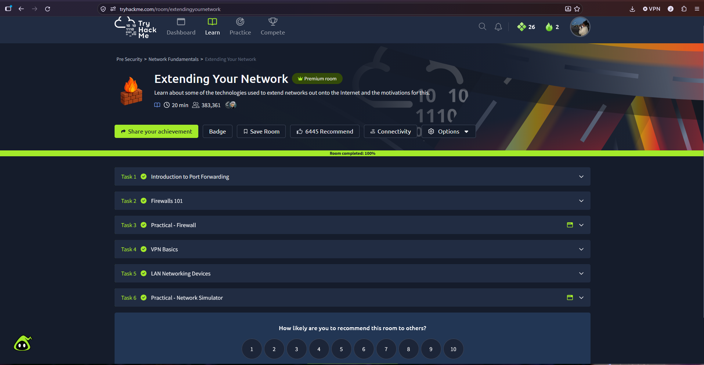
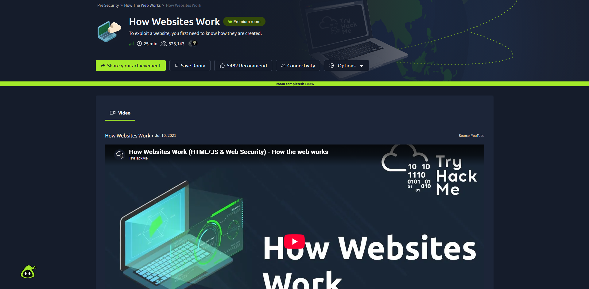

<h1>cybersecurity-learning-log</h1>

<h3>Building skills. Documenting progress. Securing systems.</h3>

  
  
  

> A public learning log for my journey through computer science, networking, Linux, web development, and blue-team cybersecurity.

<table align="center">
<tr>
<td width="50%" valign="top">

<h3><code>root@jaylan:~$ whoami</code></h3>

- <strong>Name:</strong> Jaylan Mack
- <strong>Focus:</strong> Technology + cybersecurity
- <strong>Path:</strong> Aspiring blue teamer
- <strong>Degree:</strong> Computer Science
- <strong>Graduation:</strong> May 2027

</td>
<td width="50%" valign="top">

<h3><code>root@jaylan:~$ system_status</code></h3>

- <strong>Learning:</strong> Active
- <strong>Mode:</strong> Build and document
- <strong>Current level:</strong> Foundational
- <strong>Next target:</strong> Security operations
- <strong>Rule:</strong> Learn it, practice it, explain it

</td>
</tr>
</table>

<h2><code>current_focus.exe</code></h2>

<pre>
[~] TryHackMe Pre Security
[~] Networking fundamentals
[~] Linux command line
[~] Windows fundamentals
[ ] Cyber Security 101
[ ] SOC Level 1
</pre>

<h2><code>toolkit.status</code></h2>

| Area | Tools and concepts |
|---|---|
| Programming | Python, JavaScript, HTML, CSS |
| Systems | Windows, Linux, command line fundamentals |
| Networking | TCP/IP, network basics, client-server concepts |
| Workflow | Git, GitHub, documentation |
| Security | Security principles, defensive concepts, learning labs |

## 2026-11-11 — TryHackMe: Extending Your Network

**Platform:** [TryHackMe — Extending Your Network](https://tryhackme.com/room/extendingyournetwork)

**Pathway:** Pre Security → Network Fundamentals

**Status:** Completed — 100% 

### What I learned

- Reviewed how port forwarding allows external traffic to reach services on an internal network.
- Learned the purpose of firewalls and how firewall rules control network traffic.
- Practiced basic firewall concepts through an interactive exercise.
- Reviewed VPN fundamentals and how VPNs provide secure remote connectivity.
- Studied common LAN networking devices and their roles.
- Used a network simulator to reinforce basic networking concepts.

### Evidence

- Completed all six tasks.
- TryHackMe room progress: 100%

### What I understand now

I have a better understanding of how networks extend beyond a local environment and how firewalls, port forwarding, VPNs, and networking devices affect connectivity and security.

### Next step

Continue the my learning with TryHackMe Pre Security Network Fundamentals pathway and apply these concepts in my home lab that I'm also developing at the moment.
-
</pre>

## 2026-11-10 — TryHackMe: How Websites Work 🎉

**Platform:** [TryHackMe — How Websites Work](https://tryhackme.com/room/howwebsiteswork)

**Pathway:** Pre Security → How The Web Works

**Status:** Completed — 100%

### Connection to CSC 317

This room connected directly to what I have been learning in my CSC 317 Web Development class, especially HTML and JavaScript. Understanding how websites are built is helping me recognize how vulnerabilities can appear when web applications handle user input, client-side code, and sensitive information.

### What I learned

- Reviewed how browsers and web servers communicate.
- Studied the role of HTML in structuring web pages.
- Practiced basic JavaScript concepts.
- Learned how sensitive data can be exposed through web applications.
- Explored how HTML injection vulnerabilities can occur.
- Better understood the connection between web development and cybersecurity.

### Evidence

- Completed the room with 100% progress.

### Next step

Continue building my web development skills while learning how to identify and prevent common web application vulnerabilities.

## Related projects

- [California Wildfires Information Website](https://github.com/qrainte444/climate-crisis-project-Jaylan-Jordan)
- [CSC 317 Web Design and Typesetting Project](https://github.com/qrainte444/CSC317-typesetting-assignment)

<h2><code>Mission</code></h2>

<pre>
build_skills.exe
create_projects.exe
document_progress.exe
defend_systems.exe
</pre>

## Connect

- [LinkedIn](https://www.linkedin.com/in/jaylan-mack-40603b211/)
- [GitHub](https://github.com/qrainte444)

<h3><code>learning never stops // progress gets documented</code></h3>

